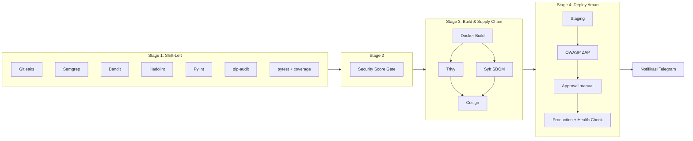

# DevSecOps Pipeline: Flask To-Do API

[](https://github.com/USERNAME/REPO/actions/workflows/pipeline.yml)


> Ganti `USERNAME/REPO` pada badge di atas dengan nama akun dan repositori GitHub Anda.

Proyek praktikum DevSecOps: aplikasi REST API sederhana (Flask) yang dilindungi pipeline CI/CD di **GitHub Actions** dengan pemindaian keamanan di setiap tahap (*shift-left*), gerbang skor keamanan, pengamanan rantai pasok (*supply chain*), dan deploy bertahap ke staging lalu production.

## Daftar Isi

- [Fitur](#fitur)
- [Alur Pipeline](#alur-pipeline)
- [Tool pada Pipeline](#tool-pada-pipeline)
- [Security Score Gate](#security-score-gate)
- [Struktur Proyek](#struktur-proyek)
- [Cara Menjalankan](#cara-menjalankan)
- [Konfigurasi GitHub Actions](#konfigurasi-github-actions)
- [Notifikasi Telegram](#notifikasi-telegram)
- [Dependabot](#dependabot)
- [Endpoint API](#endpoint-api)

## Fitur

- API To-Do dengan endpoint `/`, `/health`, dan `/tasks` (GET dan POST).
- Pemindaian rahasia, SAST, lint Dockerfile, audit dependensi, dan uji unit dengan batas cakupan.
- Skor keamanan berbobot: pipeline berhenti jika skor di bawah 80 atau ada rahasia bocor.
- Image Docker dipindai (Trivy), dibuatkan SBOM (Syft), dan ditandatangani (Cosign).
- Deploy ke staging, uji DAST (OWASP ZAP), persetujuan manual, deploy production, *health check*, dan *rollback* otomatis.
- Notifikasi hasil pipeline ke Telegram dan pembaruan dependensi otomatis lewat Dependabot.

## Alur Pipeline



## Tool pada Pipeline

| Stage | Tool | Fungsi | Pipeline gagal jika |
|---|---|---|---|
| 1 | **Gitleaks** | Mendeteksi secret/kredensial yang ter-commit | Ada secret terdeteksi (kritis) |
| 1 | **Semgrep** | SAST dengan aturan `p/python` dan `p/owasp-top-ten` | Ada temuan kode tidak aman |
| 1 | **Bandit** | SAST khusus Python (severity medium ke atas) | Ada temuan medium/high |
| 1 | **Hadolint** | Lint `Dockerfile` sesuai praktik terbaik | Ada pelanggaran aturan |
| 1 | **Pylint** | Kualitas dan gaya kode | Skor di bawah 9.0 |
| 1 | **pip-audit** | Mendeteksi CVE pada dependensi Python | Ada dependensi rentan |
| 1 | **pytest + pytest-cov** | Uji unit dan cakupan kode | Tes gagal atau cakupan di bawah 80% |
| 2 | **Security Score Gate** | Menghitung skor dari hasil Stage 1 dan mengomentari PR | Skor di bawah 80 atau Gitleaks gagal |
| 3 | **Docker Buildx** | Membangun image kontainer | Build gagal |
| 3 | **Trivy** | Memindai kerentanan image | Ada kerentanan CRITICAL yang sudah punya perbaikan |
| 3 | **Syft** | Membuat SBOM (SPDX JSON) | SBOM gagal dibuat |
| 3 | **Cosign** | Menandatangani image (keyless, OIDC) di GHCR | Push atau tanda tangan gagal |
| 4 | **OWASP ZAP** | DAST baseline ke staging | Scan tidak dapat berjalan |
| 4 | **Health check + rollback** | Memastikan `/health` sehat, kembali ke image sebelumnya jika gagal | Health check production gagal |
| Semua | **Telegram** | Notifikasi sukses/gagal ke chat Telegram | (tidak memengaruhi hasil pipeline) |

## Security Score Gate

Skor dihitung dari hasil tujuh pemeriksaan Stage 1. Lolos jika skor **≥ 80** dan Gitleaks tidak gagal.

| Pemeriksaan | Bobot |
|---|---|
| Gitleaks (kritis) | 20 |
| Semgrep | 15 |
| Bandit | 15 |
| pip-audit | 15 |
| pytest (coverage ≥ 80%) | 15 |
| Pylint (≥ 9.0) | 10 |
| Hadolint | 10 |
| **Total** | **100** |

## Struktur Proyek

```text
.
├── .github/
│   ├── dependabot.yml
│   └── workflows/
│       └── pipeline.yml
├── app/
│   ├── __init__.py
│   └── app.py
├── tests/
│   ├── __init__.py
│   └── test_app.py
├── Dockerfile
├── requirements.txt
├── requirements-dev.txt
└── README.md
```

## Cara Menjalankan

### Prasyarat

- Python 3.12
- Docker (opsional, untuk menjalankan sebagai kontainer)

### 1. Jalankan secara lokal

```bash
git clone https://github.com/USERNAME/REPO.git
cd REPO

python -m venv .venv
# Linux/macOS
source .venv/bin/activate
# Windows (PowerShell)
.venv\Scripts\Activate.ps1

pip install -r requirements-dev.txt
python -m app.app
```

Aplikasi berjalan di `http://127.0.0.1:5000`. Coba:

```bash
curl http://127.0.0.1:5000/health
curl -X POST http://127.0.0.1:5000/tasks \
  -H "Content-Type: application/json" \
  -d '{"title": "Belajar CI/CD"}'
curl http://127.0.0.1:5000/tasks
```

### 2. Jalankan uji dan pemeriksaan kualitas

```bash
pytest --cov=app --cov-report=term-missing --cov-fail-under=80
pylint app tests --fail-under=9.0
bandit -r app -ll
pip-audit -r requirements.txt
```

### 3. Jalankan dengan Docker

```bash
docker build -t todo-app .
docker run --rm -p 8080:5000 todo-app
curl http://localhost:8080/health
```

## Konfigurasi GitHub Actions

Pipeline berjalan otomatis pada `push` ke `main`, setiap `pull_request`, dan secara manual (`workflow_dispatch`). Stage 1 sampai 3 tidak butuh konfigurasi tambahan. Untuk fitur lain:

| Kebutuhan | Lokasi pengaturan | Nilai |
|---|---|---|
| Notifikasi Telegram | Settings → Secrets and variables → Actions → **Secrets** | `TELEGRAM_TOKEN`, `TELEGRAM_CHAT_ID` |
| Mengaktifkan Stage 4 | Settings → Secrets and variables → Actions → **Variables** | `STAGE4_ENABLED` = `true` |
| Persetujuan production | Settings → **Environments** | Buat `staging` dan `production`; pada `production` aktifkan *Required reviewers* |
| Runner deploy | Settings → Actions → **Runners** | Self-hosted runner di VM dengan label `self-hosted`, `linux`, `deploy` (Docker dan curl terpasang) |

Jika `STAGE4_ENABLED` belum `true`, Stage 4 dilewati dan pipeline tetap hijau. Cosign dan push image hanya berjalan pada `push` ke `main`.

## Notifikasi Telegram

Job `notify-telegram` mengirim pesan berisi status (sukses, gagal, atau dibatalkan), repositori, branch, commit, pemicu, daftar job yang gagal, dan tautan ke run.

1. Buat bot lewat [@BotFather](https://t.me/BotFather) dengan perintah `/newbot`, lalu salin token yang diberikan.
2. Kirim satu pesan ke bot Anda (atau tambahkan bot ke grup), kemudian buka `https://api.telegram.org/bot<TOKEN>/getUpdates` dan catat nilai `chat.id`. Untuk grup, nilainya biasanya negatif.
3. Simpan token sebagai secret `TELEGRAM_TOKEN` dan ID chat sebagai `TELEGRAM_CHAT_ID`.

Jika secret belum diisi, atau tidak tersedia (misalnya pada PR dari fork atau PR Dependabot), notifikasi dilewati tanpa membuat pipeline gagal.

## Dependabot

`.github/dependabot.yml` memeriksa pembaruan setiap Senin pukul 07.00 WIB untuk:

- **pip**: `requirements.txt` dan `requirements-dev.txt`
- **github-actions**: versi action pada workflow

Pembaruan minor dan patch digabung dalam satu PR per ekosistem. Setiap PR Dependabot akan melewati pipeline yang sama sebelum di-merge.

## Endpoint API

| Metode | Path | Deskripsi | Respons |
|---|---|---|---|
| GET | `/` | Informasi aplikasi | `200` |
| GET | `/health` | Health check | `200` `{"status": "ok"}` |
| GET | `/tasks` | Daftar semua tugas | `200` |
| POST | `/tasks` | Tambah tugas (`{"title": "..."}`) | `201`, atau `400` jika `title` kosong |

> Data tugas disimpan di memori proses dan hilang saat aplikasi dimulai ulang.
